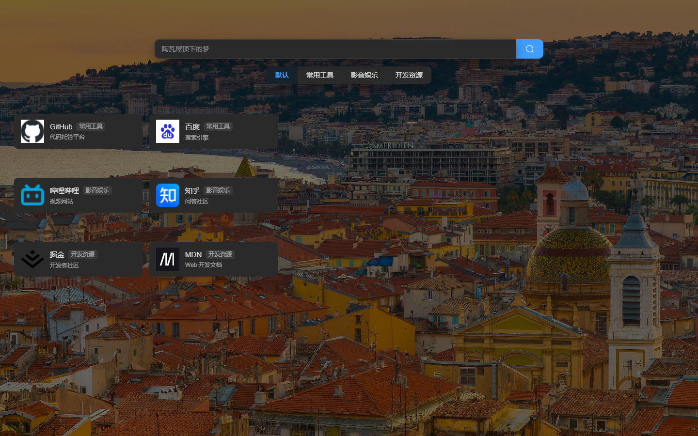
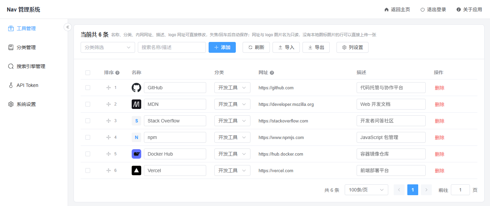

# Nav

一个轻量的导航站，内置搜索引擎、便签和后台管理，很适合作为浏览器主页使用。有配套的[浏览器插件](https://github.com/nickkk333/nav-extension)。

## 功能特性

### 导航与搜索

- 分类 + 卡片式工具导航，支持拖拽排序、隐藏工具/分类、设置每行显示数量。
- 后台添加工具时自动抓取网站图标，也可以上传本地图标；工具可额外填写**内网网址**，首页优先访问内网地址，探测不通时自动回退到公网地址。
- 多搜索引擎管理：启用/停用、排序、自定义图标与默认搜索引擎。
- 回车优先打开第一个匹配的工具卡片，没有匹配时使用默认搜索引擎；`Ctrl + Enter` 忽略卡片直接用默认引擎搜索。
- 支持域名灰显补全（`Tab` 补全）、直接访问域名，以及拼音/首字母搜索。
- 首页卡片默认隐藏，鼠标移动、滚轮或触屏点按后按设定时长显示（1-600 秒，默认 5 秒），搜索框输入时也会显示匹配卡片。
- 登录后右键卡片选择「设置」，或长按卡片进入设置模式，可直接拖拽排序、删除卡片。

### 便签

- 富文本块编辑器，支持标题、列表、引用、代码块、图片与附件（任意类型，单文件最大 100MB）。
- 便签窗口可拖动、缩放，块高度支持触摸拖动，双击底部调整线在「折叠」与「展开」之间切换。
- 自动保存，并保留最近 20 个历史版本，可随时恢复。
- 便签属于私人数据，仅登录后可见；可在后台隐藏便签入口。

### 后台管理

- 工具、分类、搜索引擎、API Token 与系统设置统一管理。
- 工具表格支持直接编辑、拖拽排序、批量刷新/重置图标，列显隐配置保存在服务端并在多设备间同步。
- 导入 / 导出全部数据（工具、分类、搜索引擎、便签与历史版本）；导入时工具/搜索引擎按 id 覆盖同一条记录，分类按名称合并，便签会写入备份内容并把原内容归档为历史版本。
- 每次启动自动把当前数据导出到 `data/nav-backup.json`，方便备份；API Token 不会写入备份文件。
- 登录失败限流：同一 IP 连续失败 10 次后锁定 10 分钟起，防止暴力破解。
- 内置「关于应用」页面，展示应用图标、简介、版本与开发者信息。

### 外观与部署

- 主题配色支持自动 / 浅色 / 深色，由服务端统一下发，保存后立即生效。
- 首页背景图可上传或填写外链，留空时自动使用必应每日壁纸。
- 适配 PC、平板与手机，后台在手机端自动切换为顶部横向导航。
- 支持无图模式、精简模式、自定义每行卡片数量、隐藏管理员/GitHub/便签入口。
- 前端由 `go:embed` 内嵌，最终只需一个可执行文件；数据库使用纯 Go 的 SQLite，无需 CGO。

## 技术栈

重构后使用前后端分离 + 单文件打包方案：

| 层 | 技术 |
| --- | --- |
| 后端 | Go 1.26、gin v1.12、gin-contrib/gzip、golang-jwt/v5、modernc.org/sqlite（纯 Go，无需 CGO） |
| 前端 | Vue 3.5、Vite 8、TypeScript 5.9、Element Plus 2.14、Pinia 4、Vue Router 5、axios、pinyin-pro、SortableJS |
| 打包 | 前端构建产物输出到 `public/`，由 Go `//go:embed` 内嵌，最终产出**单个可执行文件** |

## 目录结构

```
.
├── ui/                  # 前端（Vue3 + Vite + Element Plus）
│   ├── src/
│   │   ├── api/         # 后端接口封装
│   │   ├── components/  # 首页组件（搜索框、标签、卡片、便签等）
│   │   ├── composables/ # 组合式函数（表格拖拽排序、移动端判断等）
│   │   ├── router/      # 路由
│   │   ├── stores/      # Pinia 状态
│   │   ├── styles/      # 全局样式与暗色主题变量
│   │   ├── types/       # 类型定义
│   │   ├── utils/       # 主题、跳转方式、拼音搜索等工具
│   │   └── views/       # 页面（首页、登录、关于、后台各标签页）
│   ├── public/          # 静态资源（图标等，构建时拷贝到 ./public）
│   └── vite.config.ts   # 构建输出到 ../public
├── public/              # go:embed 目录（由前端构建生成，已 gitignore）
├── data/                # 运行时数据（自动创建，已 gitignore）
├── database/            # sqlite 初始化、迁移与查询
├── handler/             # gin 路由处理函数
├── service/             # 业务逻辑
├── middleware/          # JWT 鉴权与登录限流中间件
├── utils/ logger/ types/ goscraper/
├── api-website/         # OpenAPI 描述与 Redoc API 文档页
├── packaging/fnos-app/  # 飞牛OS（FnOS）.fpk 打包脚本（原生安装）
├── images/              # README 预览截图
├── Makefile             # 常用构建命令
├── Dockerfile           # 多阶段构建（前端 -> 后端 -> 运行镜像）
└── main.go              # 入口：初始化数据库、路由与静态资源
```

## 本地开发

> 前置条件：Go 1.26 + Node 24。Node 版本统一在根目录 `.nvmrc` 中定义（当前 `24`），`Dockerfile` 的 `NODE_VERSION` 与 CI 流水线都以此为准，改版本只需改这一处。

```bash
# 安装依赖
make install          # 等价于 npm --prefix ui install + go mod download

# 方式一：同时启动后端(6412)和前端开发服务器(2333)
make dev

# 方式二：分别启动
make dev-api          # 后端，监听 6412
make ui-dev           # 前端，监听 2333 并代理 /api 到 6412
```

浏览器访问 <http://localhost:2333> 即可（开发模式）。首次启动会在当前目录创建 `data/nav.db`，默认账号密码 `admin` / `admin`。

## 常用命令

```bash
make install          # 安装前后端依赖
make dev              # 同时启动后端与前端开发服务器
make dev-api          # 只启动后端
make ui-dev           # 只启动前端开发服务器
make ui-build         # 构建前端到 ./public
make ui-check         # 前端 vue-tsc 类型检查

make build            # 构建前端 + 编译本机可执行文件 bin/nav
make build-linux      # 构建 Linux amd64 静态二进制（Docker 镜像使用）
make build-linux-arm64
make build-windows-amd64
make build-all        # Linux amd64/arm64 + Windows amd64
make run              # 直接运行（默认 6412 端口）

make fmt vet test     # Go 格式化 / 静态检查 / 测试
make check            # fmt + vet + 前端类型检查
make goreleaser-check # 校验 .goreleaser.yml
make goreleaser-snapshot # 完整演练发布流程（产物落在 dist/）

make docker           # 构建 Docker 镜像
make docker-tar       # 导出可 docker load 的离线镜像包（默认 amd64，可用 ARCH=arm64 指定）
make docker-run       # 启动容器（映射 6412，挂载 ./data）
make docker-stop      # 停止并删除容器
make docker-multiarch # 构建并推送多架构镜像
make fnos-fpk         # 打包飞牛OS .fpk（需要 bash 环境）
make clean            # 清理构建产物
```

## 构建镜像

```bash
# 构建本地 Docker 镜像
make docker                       # 构建本 fork 镜像（默认标签 ghcr.io/nickkk333/nav:latest）

# 导出可离线 docker load 的镜像 tar
make docker-tar

# 多架构构建并推送
make docker-multiarch

# 直接使用 Dockerfile（三阶段：Node 构建前端 -> Go 编译 -> alpine 运行）
docker build --build-arg GOPROXY=https://goproxy.cn,direct -t nav:latest .
```

> 国内网络构建时可传 `--build-arg GOPROXY=https://goproxy.cn,direct` 加速 Go 依赖下载。
> 镜像构建时会自动注入版本号（`--build-arg VERSION=... --build-arg COMMIT=...`），`make docker` 已从 git 自动获取。

## 数据目录与备份

所有运行时数据都保存在数据目录下，默认是可执行文件所在目录的 `data/`（Docker 部署时对应 `/app/data`，挂载该目录即可持久化）；可用环境变量 `NAV_DATA_DIR` 指定内部数据目录、`NAV_FILES_DIR` 指定便签附件与壁纸的根目录（飞牛OS 原生安装默认使用共享目录）：

内部数据（`NAV_DATA_DIR`，默认 `./data`）：

```
data/
├── nav.db                 # SQLite 数据库
├── nav-backup.json        # 每次启动自动导出的完整备份
├── images/                # 后台上传的图片、工具/搜索引擎图标
└── imgcache/              # 自动抓取的网站图标缓存
```

用户文件（`NAV_FILES_DIR`，默认与内部数据目录相同；飞牛OS 原生安装默认是共享目录 `Nav`）：

```
data/
├── memo-files/            # 便签图片与附件
├── 必应壁纸-YYYYMMDD-描述.jpg  # 历史必应壁纸（只增不删）
└── 每日壁纸.jpg            # 当天壁纸的固定路径副本
```

- 启动时会异步导出一次 `nav-backup.json`，同名覆盖，失败不影响服务启动。
- 便签附件与必应壁纸的存储目录可在后台「系统设置」中修改（留空分别使用默认 `<用户文件目录>/memo-files` 与 `<用户文件目录>`）；修改后已有文件不会自动迁移，需要手动拷贝。
- 后台「工具管理 → 导入 / 导出」可手动导出或导入完整备份；工具/搜索引擎按 id 覆盖，分类按名称合并，便签写入备份内容并把原内容归档为历史版本。
- 为安全起见，**API Token 不会写入导出文件**。
- 旧版本导出的 `van-nav-backup.json` 不会自动删除，确认无用后可手动清理。

## 使用技巧 / 快捷键

这个导航站有很多小设计，合理使用可以提高效率：

- 只要在页面里，直接按键盘任意按键即可聚焦搜索框开始输入。
- 按回车优先打开**第一个匹配的工具卡片**；没有任何工具卡片匹配时，才用**默认搜索引擎**搜索（后台「系统设置 → 默认搜索引擎」）。
- 搜索框支持**域名补全**：输入域名前缀（如 `git`）时框内灰显剩余部分（如 `hub.com`），按 `Tab` 自动补全。
- 输入像域名（含 `.com`/`.cn` 等、至少两段、无空格和协议符号）时，按回车或 `Ctrl + Enter` 会**直接访问该域名**，而不是搜索。
- `Ctrl + Enter`：忽略卡片匹配，直接用**默认搜索引擎**搜索（不考虑是否启用），结果在新标签页打开、保留导航页。
- 默认搜索引擎设为特定引擎时：回车有启用的引擎就用第一个启用的，全禁用时才用选中的那个；`Ctrl + Enter` 始终用选中的那个。
- 搜索时卡片右上角会显示结果序号，按 `Ctrl`/`⌘` + 对应数字可直接打开该结果（最多前 10 个）。
- 登录后右键卡片选择「设置」，或长按卡片进入设置模式，拖拽排序或删除；再次右键空白处退出。
- 便签入口仅登录后显示，可在后台隐藏；展开便签后搜索框自动切换为纯网页搜索。
- 跳转方式、主题配色、卡片显示时长、每行卡片数量、无图/精简模式、便签附件与壁纸存储目录等都可以在后台「系统设置」中调整。

后台「系统设置」里可以直接上传图片：首页背景图、网站 logo、logo192 / logo512 都支持上传（也可以直接填写图片外链）；上传的图片保存在 `data/images` 下。

## 必应每日壁纸

首页背景图留空时会自动使用**必应每日壁纸**，三种触发方式（互相兜底）：

| 时机 | 说明 |
| --- | --- |
| 开机/启动 | 进程启动时异步下载一次 |
| 每天固定时间点 | 默认每天 08:00（本地时区）定时触发 |
| 每天首次访问 | 兜底：本地一张壁纸都没有时才同步拉一次（已有图片不重复下载） |

壁纸保存为 `data/必应壁纸-YYYYMMDD-图片描述.后缀`，**历史壁纸只增不删**；离线或下载失败时沿用上一次保存的图片，不影响启动。

每次更新壁纸后还会覆盖一份固定路径的副本 `data/每日壁纸.后缀`（扩展名跟随实际图片格式），方便脚本或其它程序始终读取同一个文件。

> 壁纸存储目录可在后台「系统设置 → 壁纸存储目录」中修改，留空使用默认文件目录；修改后历史壁纸不会自动迁移，会在新目录重新下载当天壁纸。

## API 文档

- OpenAPI 描述：`api-website/openapi.yaml`
- Redoc 页面：`api-website/index.html`（用任意静态服务器打开，例如 `npx --yes serve api-website`）

需要程序化访问时，在后台「API Token」页面新建 Token，然后在请求头 `Authorization` 中携带登录 JWT 或该 Token 即可。

## 预览

### 首页



### 管理后台



## 发布产物（GitHub Release）

推送 `v*` tag 后会自动发布，Release 中包含：

| 产物 | 说明 |
| --- | --- |
| `nav_<版本>_windows_amd64.zip` | Windows amd64 单文件可执行程序 |
| `nav_<版本>_linux_amd64.tar.gz` | Linux amd64 静态二进制（另有 arm64 / arm 版本） |
| `nav_<版本>_darwin_amd64.tar.gz` | macOS amd64 / arm64 单文件可执行程序 |
| `nav-docker-amd64.tar.gz` | Docker 离线镜像包，`gunzip -c ... \| docker load` 后即可运行（另有 arm64 版） |
| `nav-fnos-amd64.fpk` | 飞牛OS（FnOS）amd64 安装包，可在应用中心「手动安装」导入（原生安装，不使用 Docker） |
| `checksums.txt` | 上述二进制包的校验值 |

同时会把多架构镜像推送到 GHCR：`ghcr.io/<owner>/<repo>:latest` 与 `ghcr.io/<owner>/<repo>:<tag>`。

> 打 tag 之前建议先确认 `Check` 流水线（`check.yml`）为绿：它会执行 `goreleaser check`、用 `.nvmrc` 的 Node 构建前端，并在非 PR 场景跑一次不发布的快照构建。
> 本地等价命令：`make goreleaser-check`（快速校验配置）、`make goreleaser-snapshot`（完整演练，产物落在 `dist/`）。

## 安装方法

### Docker

```bash
docker run -d --name nav --restart always -p 6412:6412 -v /path/to/your/data:/app/data ghcr.io/nickkk333/nav:latest
```

打开浏览器 [http://localhost:6412](http://localhost:6412) 即可访问。

也可以参照 `Makefile` 中的 `docker` / `docker-run` 命令：

```bash
make docker       # 构建本 fork 镜像（默认 ghcr.io/nickkk333/nav:latest）
make docker-run   # 启动容器（映射 6412，挂载 ./data）
```

环境变量：

| 变量 | 说明 | 默认 |
| --- | --- | --- |
| `NAV_JWT_SECRET` | JWT 签名密钥，不设置时每次启动随机生成（重启后旧登录态失效） | 随机 |
| `NAV_DATA_DIR` | 内部数据目录（数据库、图片、图标缓存、自动备份） | `./data` |
| `NAV_FILES_DIR` | 用户文件目录（便签附件、必应壁纸的默认位置） | 同 `NAV_DATA_DIR` |
| `-port` / `-addr` | 监听端口与地址（启动参数，非环境变量） | 6412 / 0.0.0.0 |

- 默认端口 6412
- 默认账号密码 `admin` / `admin`，第一次运行后请进入后台修改
- 数据库与图片等数据会自动创建在 `data/` 目录中（Docker 内为 `/app/data`）

### 可执行文件

下载 Release 中对应平台的二进制文件，直接运行即可。

打开浏览器 [http://localhost:6412](http://localhost:6412) 即可访问。

- 默认端口 6412，启动时添加 `-port <port>` 参数可指定运行端口。
- 默认监听地址 `0.0.0.0`，可添加 `-addr <addr>` 参数指定。
- 默认账号密码 `admin` / `admin`，第一次运行后请进入后台修改。
- 数据库会自动创建在程序目录的 `data/nav.db`。

也可以自行编译带前端界面的单文件程序：

```bash
make build            # 本机平台，产物在 bin/nav
make build-linux      # Linux amd64 静态二进制
```

### 飞牛OS（FnOS）

`.fpk` 采用**原生安装**（不使用 Docker）：由飞牛为应用创建的用户 `nav` 直接运行，安装体积小，也能按需读写宿主机目录。

1. 在 Release 页面下载 `nav-fnos-amd64.fpk`。
2. 飞牛桌面 → **应用中心** → 左下角 **手动安装** → 上传该 `.fpk` → 确定。
3. 安装向导会询问**文件存储目录**（便签附件与必应壁纸）：
   - **留空**（推荐）：使用飞牛共享目录 `Nav`，安装后可在「文件管理 → 应用文件」中查看，权限由系统自动配置。
   - **填写宿主机绝对路径**（如 `/vol1/1000/nav`）：安装完成后到 **应用中心 → Nav → 应用设置 → 授权目录** 给本应用添加该目录的**读写**权限。授权前应用可以正常打开，但附件上传与壁纸下载会失败；授权后会自动写入该目录，**不需要重装或重启**。
4. 安装完成后打开桌面图标，或访问 `http://<飞牛IP>:6412`，默认账号密码 `admin` / `admin`。

说明：

- 数据库、上传图片、图标缓存与自动备份放在应用私有数据目录（`/vol1/@appdata/nav`），不占用共享目录；便签附件与壁纸默认放在共享目录 `Nav`。
- 从旧版 **Docker 安装**切换到原生安装：旧数据原本就在共享目录 `Nav` 里，安装或升级时会自动把 `nav.db` 与 `images` / `imgcache` 导入应用私有目录，共享目录里的壁纸与便签附件仍按原路径继续使用；如果提示无法读取旧库（容器以 root 写入），请在文件管理里把 `Nav` 目录权限改为可读写后重试，或先在旧版后台导出备份再导入。
- 原生安装以普通应用用户运行，没有 root 权限；写共享目录以外的宿主机路径必须通过「授权目录」授权。
- 后台「系统设置」里的「便签附件存储目录」「壁纸存储目录」在原生安装下可以直接填宿主机路径（同样需要授权目录），留空则使用安装时配置的目录。
- 卸载时选择「保留现有文件」会保留应用数据目录与共享目录，重新安装后数据仍在；选择「清除所有套件数据文件」会删除应用私有数据（`/vol1/@appdata/nav`），共享目录 `Nav` 里的附件与壁纸不会被删除，需要时请手动清理。

## 浏览器插件

具体请看：[浏览器插件仓库](https://github.com/nickkk333/nav-extension)

具有一键增加工具、快速打开管理后台和主站等功能，具体自行探索。

## 参与开发

前端为 **Vue 3 + Element Plus**（`ui/` 目录），后端为 **Go + gin + SQLite**。接口约定见 `ui/src/api/index.ts`、`handler/handlers.go` 与 `api-website/openapi.yaml`。

如果你有 Go 和 Vue 3 开发经验，可以很轻松上手。修改前端时使用 `make ui-dev` 启动开发服务器即可，接口会自动代理到本地后端。

## License

[MIT](LICENSE)
